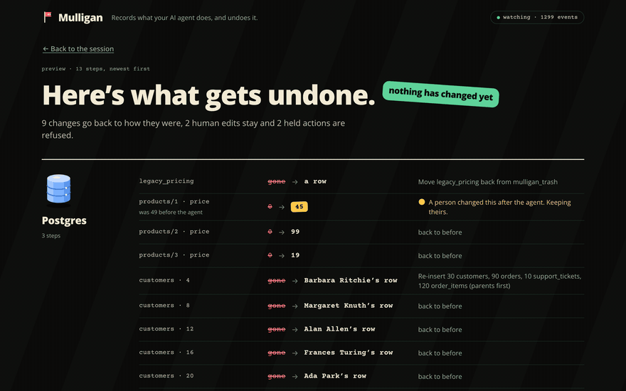
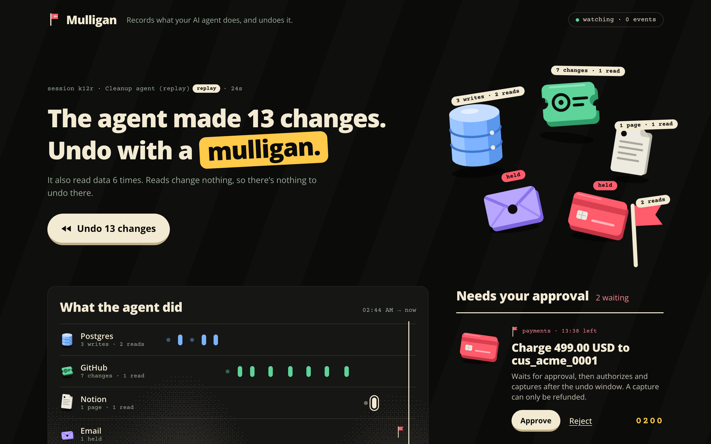
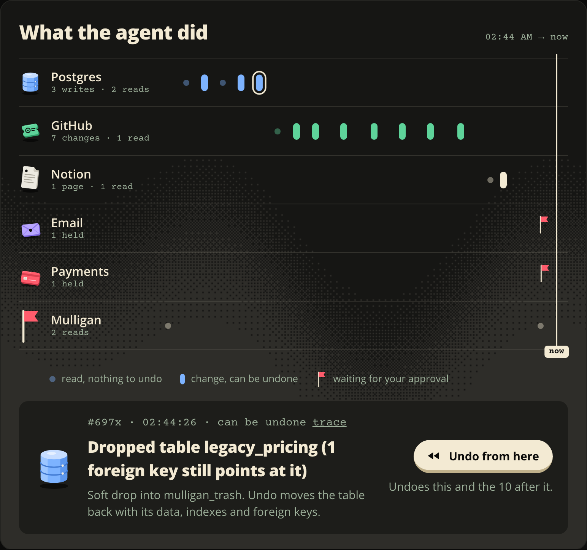
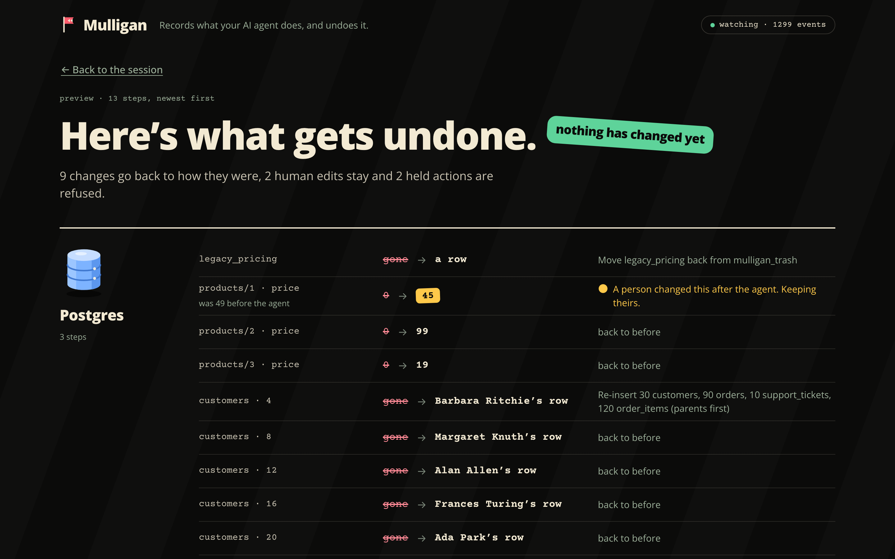
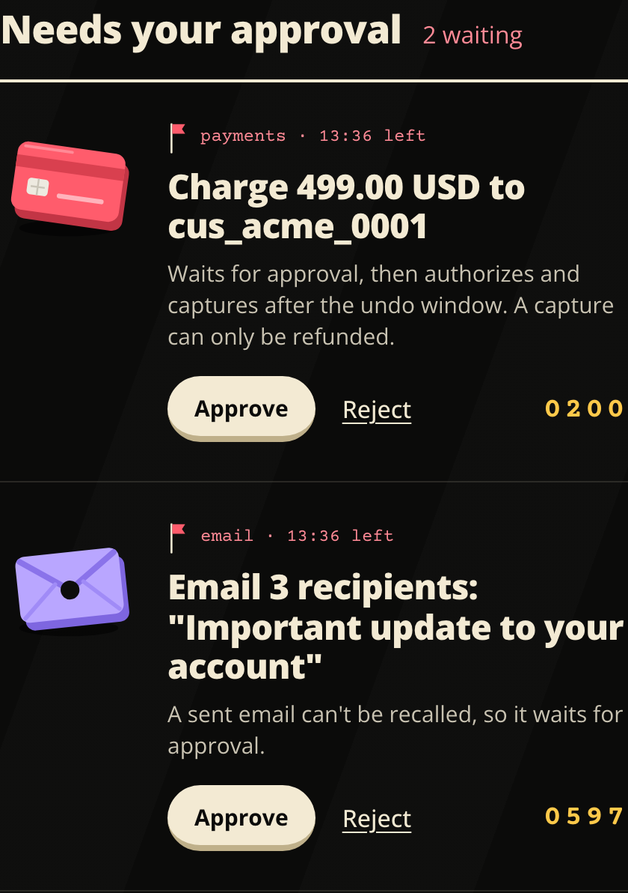
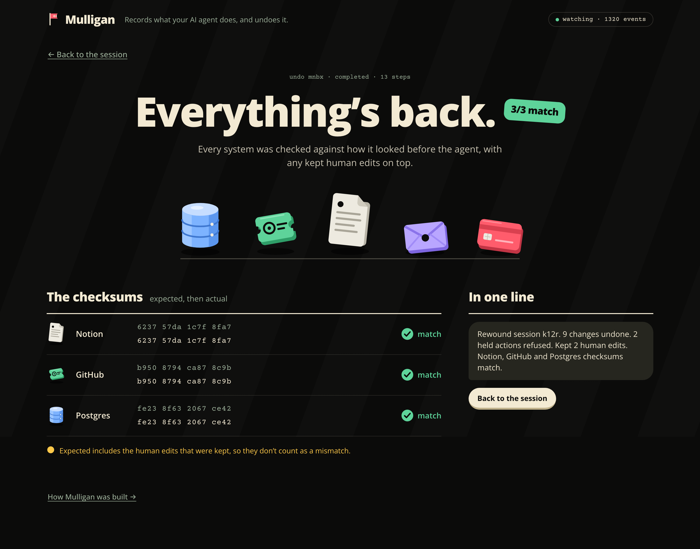
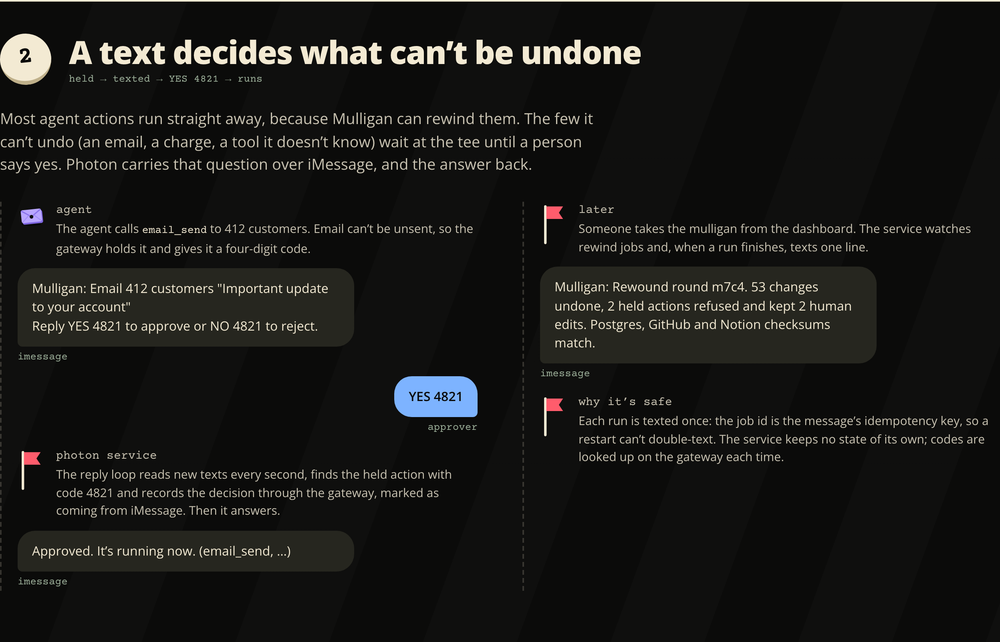
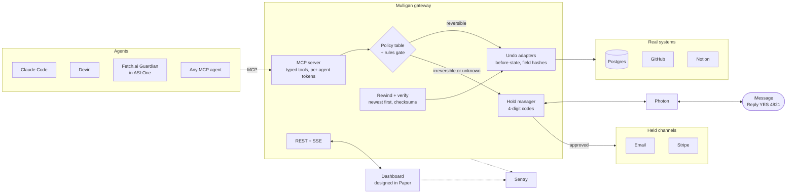
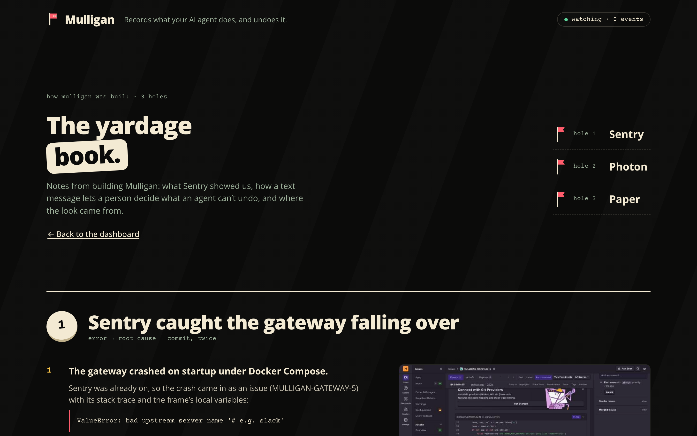

<div align="center">

# ⛳ Mulligan

### A do-over for AI agents.

**Agents can run anything. Mulligan lets you undo everything they did.**

[](https://modelcontextprotocol.io)
[](gateway/)
[](gateway/)
[](dashboard/)
[](infra/db/)
[](#built-with)
[](fetch-agent/)
[](fetch-agent/)


</div>

> In July 2025, an AI coding agent deleted a company's production database during a code freeze.
> Agents now write to databases, close tickets, edit docs, send email and move money, and when one goes wrong, the cleanup is manual and often impossible.
>
> **Mulligan is the layer agents act through.** It records every action with its before-state, holds the ones that can't be undone until a person says yes over iMessage, and rewinds a whole agent session across Postgres, GitHub and Notion in one click, keeping any edit a person made since and proving with checksums that everything else is exactly as it was.

<p align="center"><b>Backups restore a database. Mulligan undoes an agent.</b></p>

---

## Contents

- [What it does](#what-it-does)
- [See it](#see-it)
- [How it works](#how-it-works)
- [Key ideas](#key-ideas)
- [Works with any MCP agent](#works-with-any-mcp-agent)
- [Quickstart](#quickstart)
- [Project structure](#project-structure)
- [Tech stack](#tech-stack)
- [Built with](#built-with)

---

## What it does

Agents connect to Mulligan as an **MCP server**. Mulligan holds the real credentials, so there is no way around it.

| | |
|---|---|
| 📼 **Records every action** | Each tool call is logged with its before-state, a hash of every field it changed, and a recipe for undoing it. |
| ⏪ **Rewinds a whole session** | One button undoes an agent's session (or everything from one action onwards) across Postgres, GitHub and Notion, newest action first. |
| 🙋 **Keeps human edits** | If a teammate changed a field after the agent did, the rewind keeps their change and flags it instead of overwriting it. |
| ✋ **Holds what can't be undone** | Emails, payments and unknown tools wait for approval. A text arrives over iMessage: *"Reply YES 4821 to approve."* |
| 💳 **Gives money an undo window** | An approved charge is authorized now and captured only after the undo window closes. A rewind cancels the authorization, or refunds it once captured. |
| ✅ **Proves the restore** | After every rewind, each system is checksummed and compared with how it looked before the agent, kept human edits included. |

## See it

**The rewind.** A cleanup agent deleted 30 customers (cascading into 90 orders, 120 order items and 10 support tickets), zeroed the Widget prices, dropped a pricing table, closed GitHub issues, rewrote the Notion pricing doc, and tried to email customers and charge a card. One click puts it all back:

<p align="center"></p>

<table>
<tr>
<td width="50%"><br><sub><b>The session.</b> What the agent changed, per system, and what's waiting on a person.</sub></td>
<td width="50%"><br><sub><b>The timeline.</b> Reads are dots, undoable changes are bars, held actions are flags. Every action links to its Sentry trace.</sub></td>
</tr>
<tr>
<td width="50%"><br><sub><b>The plan.</b> A dry run first: every field, its agent value and what it goes back to. A teammate's later price edit stays.</sub></td>
<td width="50%"><br><sub><b>The holds.</b> The charge and the email never ran. Each has a four-digit code for the iMessage approval.</sub></td>
</tr>
<tr>
<td width="50%"><br><sub><b>The proof.</b> Expected and actual checksums for every system, plus the one-line summary that is also texted.</sub></td>
<td width="50%"><br><sub><b>The texts.</b> An approval over iMessage via Photon, and the summary sent when a rewind finishes.</sub></td>
</tr>
</table>

## How it works



1. **An agent calls a tool.** It authenticates with its own bearer token, so every action is tied to an agent and a session.
2. **The policy table labels it.** Every built-in tool has a fixed label: `read_only`, `reversible`, `reversible_noisy`, `compensable` or `irreversible`. Tools from MCP servers placed behind Mulligan go through the rules gate instead.
3. **Reversible calls run right away.** The adapter captures the before-state, runs the call, hashes every field it changed and stores the inverse.
4. **Irreversible calls are held.** They get a four-digit code and an iMessage to the approver. Nothing runs until someone replies `YES 4821` or presses Approve on the dashboard.
5. **A rewind runs newest first.** For each action, the adapter re-reads every field the agent wrote, restores the ones that still hold the agent's value and keeps the rest. Held actions are refused, uncaptured payments are cancelled, captured ones refunded.
6. **Every system is verified.** Postgres, GitHub and Notion are checksummed and compared with the pre-session state plus any kept human edits. A one-line summary is texted when the rewind finishes.

## Key ideas

### 🔧 Typed tools, never raw SQL
Agents get `pg_delete_rows`, `pg_update_rows`, `pg_drop_table`, `github_close_issue`, `notion_update_page` and friends. Postgres write tools take a table, a structured filter (`[{column, op, value}]`) and values, so Mulligan knows exactly which rows a call will touch before it runs, and deleting every row needs an explicit `all: true`. `pg_query` accepts SQL, but runs as a SELECT-only role inside a `READ ONLY` transaction, with a statement timeout and a row cap.

### 🗑️ Soft drop
`pg_drop_table` doesn't drop anything. It moves the table into a hidden `mulligan_trash` schema (agents can't see it) along with its indexes and sequences. Undoing the drop moves it back with its data, primary key, indexes and every foreign key that points at it. Cascading deletes come back parents first, so foreign keys never break.

### 🧬 Per-field conflict detection
Every action stores a SHA-256 hash of each field it changed, down to `postgres:products/42/price`, a GitHub issue's state or labels, a file's blob sha, or a single Notion block. At rewind time, a field whose current hash no longer matches what the agent wrote was changed by someone else: Mulligan keeps that edit, flags it on the dashboard, and restores everything around it. No three-way merges, no silent overwrites.

### 🚦 Policy table and rules gate
[`contracts/reversibility_policy.yaml`](contracts/reversibility_policy.yaml) labels every built-in tool, and the gateway refuses to start if one is missing. Mulligan can also sit in front of other MCP servers, exposing their tools as `upstream__<server>__<tool>`. Those have no policy entry and no undo adapter, so a deterministic rules gate reads each tool's name, description and MCP annotations. A call runs only if the tool clearly just reads: its name starts with a read verb, its description has no write verb, and its annotations don't say otherwise. Everything else waits for approval with the reason shown. **It fails closed**, and it never overrides the policy table.

### ✅ Verified rewinds
A rewind isn't done when the last step returns. Each adapter computes a canonical checksum of its system (sorted, normalized rows; issues, comments and file blobs; page properties and block trees), and the dashboard shows expected against actual for each one. The expected side includes the human edits that were kept, so a correct rewind always matches.

## Works with any MCP agent

Mulligan speaks MCP over Streamable HTTP. Anything that can add a remote MCP server can be protected.

<table>
<tr>
<td width="33%" valign="top">

### Claude Code

```bash
claude mcp add --transport http mulligan \
  http://127.0.0.1:8001/mcp \
  --header "Authorization: Bearer <token>"
```

[`infra/demo-agent/`](infra/demo-agent/) adds a `PreToolUse` hook that blocks direct database, GitHub and Notion access, so Mulligan is the only route.

</td>
<td width="33%" valign="top">

### Devin

`make tunnel` gives the MCP port, and only the MCP port, a public HTTPS URL. Add it in Devin under **Customize → MCPs → custom → HTTP** with a bearer token.

*Even Devin can be undone:* its sessions show up on the dashboard and rewind like any other agent's.

</td>
<td width="33%" valign="top">

### Fetch.ai Guardian

A Guardian agent in **ASI:One** chat hands a task to a worker agent that acts only through Mulligan. It reports what changed and what's held, sends each held action as an approve/reject card, and undoes the whole session when you say **"rewind"**.

[fetch-agent/README.md](fetch-agent/README.md)

</td>
</tr>
</table>

| Fetch.ai agent | Address |
|---|---|
| `mulligan-guardian` (Agent Chat Protocol, mailbox) | `agent1qveg9ca3jn06upx2ztx78k40kjm4jxg2ywuul2lmfrvc77druqwp6qae9w4` |
| `mulligan-worker` (acts through Mulligan's MCP tools) | `agent1q2hqgd60cdsfxhda3tyesj0zmyca4mle66c6varrj6gmzrfhp88aqsrdngz` |

Guardian profile: [agentverse.ai](https://agentverse.ai/agents/details/agent1qveg9ca3jn06upx2ztx78k40kjm4jxg2ywuul2lmfrvc77druqwp6qae9w4/profile)

## Quickstart

Needs Docker, [uv](https://docs.astral.sh/uv/) and Node 22. Use sandbox and test credentials only.

```bash
cp .env.example .env   # set the MULLIGAN_*_TOKEN(S) values and your sandbox keys
make up                # both databases, the gateway, the Photon service, the dashboard and Mailpit
```

Open the dashboard at **http://127.0.0.1:5173**. Then run the demo:

```bash
make demo-reset        # reseed Postgres, GitHub and Notion, clear the log, print checksums
make demo-replay       # a recorded cleanup agent goes rogue, through Mulligan
make teammate-edit     # a teammate fixes a price by hand after the agent
```

Press **Undo** on the dashboard. Watch every system come back, the teammate's fix stay, and the checksums match. `make demo-live` runs the same agent live on Claude instead of the recording.

<details>
<summary><b>Run the pieces on the host, connect agents, and run the checks</b></summary>

```bash
make setup             # gateway Python deps
make db                # mulligan-db (TimescaleDB) and prod-db (the demo company)
make gateway           # REST + SSE on 127.0.0.1:8000, MCP on 127.0.0.1:8001/mcp
make fetch-worker      # Fetch worker agent (:8011)
make fetch-guardian    # Fetch Guardian for ASI:One (:8010, mailbox)
make tunnel            # public HTTPS URL for the MCP port only, for Devin
```

Each agent gets its own token in `MULLIGAN_AGENT_TOKENS` (`claude_code:<token>,devin:<token>,fetch:<token>,…`). A rewind can also be started over REST: `POST /api/rewind {"scope": {"session_id": …}, "dry_run": false}`.

```bash
make ci                # contract types, OpenAPI lint, ruff, mypy, unit tests, Photon, dashboard, Fetch
make test-integration  # against `make db`
make check-exposure    # every route needs a token; only /mcp is reachable through the tunnel
make load-check        # 200 actions in one session rewound in under 30 s, checksum restored
```

`make help` lists every target.

</details>

## Project structure

```
mulligan/
├── contracts/           # The source of truth: action schema, OpenAPI, SSE events, MCP tools, reversibility policy
├── gateway/             # Python 3.12 · FastAPI + the official MCP SDK
│   └── mulligan/
│       ├── mcp_server/  #   MCP server, typed tool registry, upstream pass-through, per-agent auth
│       ├── api/         #   REST /api/* and SSE /api/events
│       ├── log/         #   action log (TimescaleDB)
│       ├── orchestrator/#   rewind planning (newest first) and verification
│       ├── adapters/    #   postgres/ github/ notion/: real undo and per-field conflict detection
│       ├── holds/       #   email and payments held channels, approval state machine
│       └── classify/    #   policy lookup and the rules gate for unknown upstream tools
├── approvals-photon/    # TypeScript · Photon iMessage approvals and rewind summaries
├── dashboard/           # React + Vite · the session timeline, holds, rewind and proof (and #/evidence)
├── fetch-agent/         # uAgents Guardian + worker for ASI:One
├── demo/                # Seeded company, rogue agent (live + replay), teammate edit, mock upstream MCP server, reset
├── infra/               # Database init (audit triggers, read-only role, trash schema), demo-agent hook, exposure check
└── docs/                # SDK notes and README assets
```

Further reading: [MULLIGAN_IDEA.md](MULLIGAN_IDEA.md) · [PLAN.md](PLAN.md) · [CONTRIBUTING.md](CONTRIBUTING.md) · [docs/SDK_NOTES.md](docs/SDK_NOTES.md)

## Tech stack

| Layer | What |
|---|---|
| **Gateway** | Python 3.12, FastAPI, Uvicorn, official `mcp` SDK (Streamable HTTP), Pydantic v2, psycopg 3, sse-starlette |
| **Storage** | TimescaleDB (action log and events), Postgres 16 (the demo company, with audit triggers) |
| **Systems** | Postgres, GitHub REST API, Notion API, SMTP (Mailpit in the demo), Stripe (manual capture) |
| **Approvals** | TypeScript, Photon (`@photon-ai/api`) over iMessage |
| **Dashboard** | React 19, Vite, TypeScript, Paper Shaders (`@paper-design/shaders-react`), designed in Paper |
| **Agents** | Claude Code, Devin, Fetch.ai uAgents + Agent Chat Protocol in ASI:One, a live rogue agent on Claude (Anthropic SDK) |
| **Observability** | Sentry: Tracing, MCP monitoring, Logs, Session Replay and error monitoring across all three services |
| **Infra** | Docker Compose, cloudflared quick tunnel (MCP port only), uv, Prism mocks, GitHub Actions |

## Built with

| | |
|---|---|
|  | The Mulligan Guardian lives in ASI:One chat and drives a multi-agent workflow (Guardian → worker → Mulligan) over the Agent Chat Protocol. |
|  | **Devin helped build Mulligan.** It wrote the randomized undo fuzz test ([`gateway/tests/test_undo_fuzz.py`](gateway/tests/test_undo_fuzz.py)): seeded sessions of inserts, updates, cascading deletes, primary-key changes and drops, plus a teammate edit that must be kept, each required to rewind to the exact pre-session checksum. The fuzz test found three verification bugs, and Devin fixed them ([PR #17](https://github.com/Manas-33/mulligan/pull/17)). Devin also connects to Mulligan as a protected agent. |
|  | A span for every agent action and every rewind, MCP server monitoring, gateway Logs, dashboard Session Replay (text masked) and errors from all three services. A real startup crash in Sentry led to [`e71db3f`](https://github.com/Manas-33/mulligan/commit/e71db3ffaab2f35ad6cc02cda09415151be6689c), and missing rewind traces led to [`9688334`](https://github.com/Manas-33/mulligan/commit/96883341e40e4f347267818f22df527827de3de2). |
|  | Approvals for held actions and one-line rewind summaries over iMessage. Each rewind summary is sent once, keyed by the rewind job. |
|  | The dashboard was designed in Paper first: the course, the hand-drawn system objects and the dithered textures, which render through Paper Shaders. |
|  | Agent payments with an undo window: authorize on approval, capture after the window, cancel or refund on rewind. |

The story behind each of these, with links and screenshots, is on the dashboard's **How Mulligan was built** page (`#/evidence`).

<p align="center"></p>

<p align="center"><sub>⛳ Take a mulligan.</sub></p>
